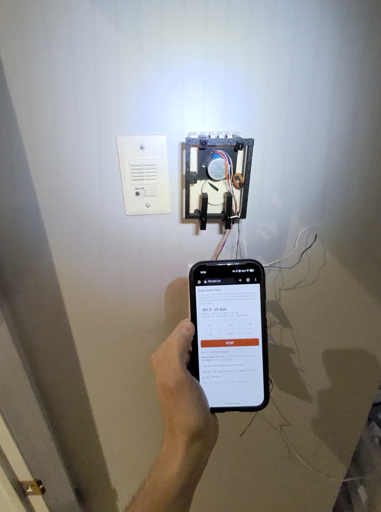
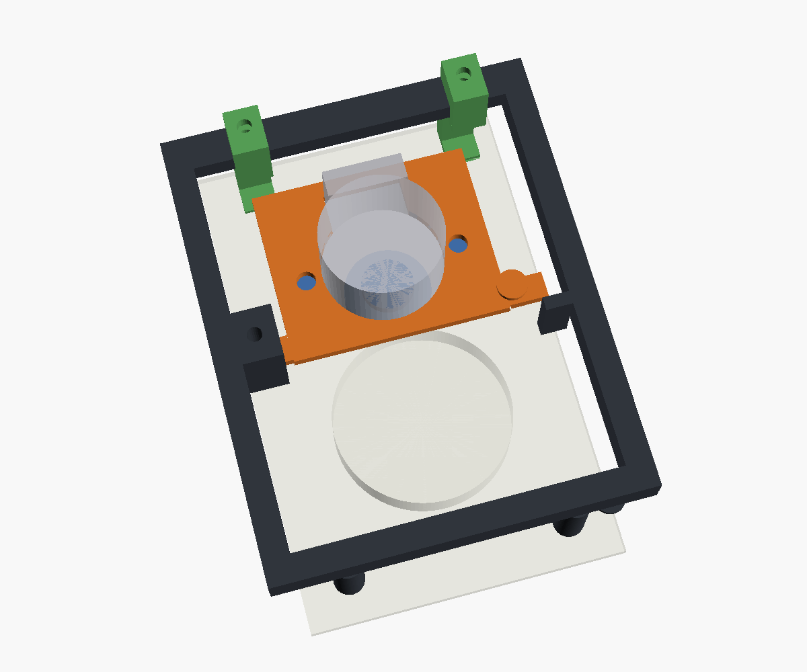

# Thermostat Dial Controller

Turn a mechanical wall thermostat's dial from your phone, using an ESP32, a 28BYJ-48 stepper and a 3D-printed clip-on mount. You don't open or rewire the thermostat.

https://github.com/user-attachments/assets/8661883c-a63f-48c8-9f15-81347920d3a2





## How it works

A printed frame hangs from the thermostat's top vents on two clips, and a bottom slider clip stops it rotating. A hinged motor plate on the frame presses a 20 mm friction wheel onto the rim of the thermostat dial, and a rubber band adds the extra pressure. The ESP32 serves a small web page on your Wi-Fi network. Each button press moves the wheel a capped number of steps and then turns the motor coils off.

The thermostat stays in its original enclosure. Nothing touches its wiring.

## Parts list

| Qty | Part | Notes |
|---|---|---|
| 1 | ESP32 dev board (ESP32-WROOM, "ESP32 Dev Module") | Any board with GPIO 16-19 and a 5V/VIN pin |
| 1 | 28BYJ-48 stepper motor, 5 V | 5.0 mm double-D output shaft |
| 1 | ULN2003 driver board | Usually sold with the 28BYJ-48 |
| 1 | 5 V power supply, 1 A or more | Powers both the motor and the ESP32 |
| 2 | Lever connectors (e.g. WAGO 221) | Shared +5 V and GND (optional, any method works) |
| 2 | M3 screws + nuts | Motor ears to the hinge plate |
| 1 | M3 x 20 screw + nut | Hinge pin (nut goes in the trap on the back of the frame) |
| 2 | M3 x 10 screws + nuts | One clamp screw per top clip (captive nut) |
| 1 | M3 x 10-16 screw + nut | Bottom slider clamp (captive nut) |
| 1 | Rubber band | Between the plate hook and the frame hook. Adds wheel pressure. |
| - | Jumper wires | 4 signal wires + power |

### Printed parts (`stl/`)

| File | Contents |
|---|---|
| `wheel_drive_mount_v0_2_frame_plate_wheel.stl` | Frame, hinged motor plate and 20 mm double-D wheel on one plate |
| `front_clip_v0_5_x2.stl` | Two top clips that hook into the thermostat's top vents |
| `bottom_slider_clip_v0_1.stl` | Slider that hooks into a bottom vent and clamps the frame's bottom bar |

Printed in PLA on a Bambu P2S (0.4 mm nozzle) in the orientation of the STL files, without brim.

### Parametric source (`cad/`)

OpenSCAD sources for every printed part. `cad/lib/dial_mount_lib.scad` holds the shared geometry (motor mount holes, double-D bore, captive-nut clamp, vent clip). Choose a part with `-D part="..."`:

```sh
cd cad
openscad -o mount.stl  -D 'part="mount_plate"'  thermostat_wheel_drive_mount_v0_2.scad
openscad -o clips.stl  -D 'part="clips_plate"'  thermostat_front_clip_v0_5.scad
openscad -o slider.stl -D 'part="slider_print"' thermostat_bottom_slider_clip_v0_1.scad
openscad -D 'part="assembly"' thermostat_wheel_drive_mount_v0_2.scad   # preview
```

Each file also has `*_collision` parts, which must render empty.

**The mount is sized for one specific thermostat**, an Ouellet OTL101C line-voltage thermostat:
- 72 x 113 mm front;
- 40.64 mm dial;
- 2.3 mm front panel;
- slotted vents about 5 mm wide.

For another thermostat, measure yours and change the parameters at the top of each `.scad` file.

## Wiring

Full table: [`docs/wiring.md`](docs/wiring.md).

| From | To |
|---|---|
| ULN2003 IN1 / IN2 / IN3 / IN4 | ESP32 GPIO 16 / 17 / 18 / 19 |
| ULN2003 `+` | +5 V supply |
| ULN2003 `-` | GND |
| ESP32 5V / VIN | +5 V supply |
| ESP32 GND | GND |
| Motor plug | ULN2003 motor socket (keyed) |

Power the motor from 5 V, never from the ESP32's 3V3 pin. The ESP32 and the ULN2003 must share ground.

## Build and flash

You need [arduino-cli](https://arduino.github.io/arduino-cli/) (or the Arduino IDE) with the ESP32 core installed:

```sh
arduino-cli core install esp32:esp32
```

1. Create your config:

   ```sh
   cp firmware/dial_controller/config.example.h firmware/dial_controller/config.h
   ```

   In `config.h`, set your Wi-Fi name and password. You can also set a hostname and an OTA password. `config.h` is git-ignored.

2. Compile and upload over USB. Use 115200 baud: the default upload speed failed on the board used here.

   ```sh
   arduino-cli compile --fqbn esp32:esp32:esp32 firmware/dial_controller
   arduino-cli upload -p <serial-port> --fqbn esp32:esp32:esp32 \
     --upload-property upload.speed=115200 firmware/dial_controller
   ```

   Find `<serial-port>` with `arduino-cli board list`; on macOS it looks like `/dev/cu.usbserial-XXXX`.

3. Open a serial monitor at 115200 baud. The board prints its IP address and its `http://<hostname>.local` address.

Later updates can go over Wi-Fi (ArduinoOTA): `arduino-cli upload -p <board-ip> --fqbn esp32:esp32:esp32 firmware/dial_controller`.

## How to use

1. Install the mount: hook the two top clips into the top vents, hang the frame on them and tighten the clip screws. Then fit the bottom slider: hook it over the frame's bottom bar, slide it up into a bottom vent and tighten its screw. Stretch the rubber band between the plate hook and the frame hook.
2. Open `http://esp32-dial.local` (or the board's IP) on a phone connected to the same Wi-Fi network.
3. **Set zero:** turn the dial by hand all the way **down** to its coldest stop, then tap **Set zero here**.
4. Tap **+ 32**. If the dial turned **down** instead of up, tap **Reverse** once. The direction setting is lost on reboot, so check it again after every power cycle.
5. Use the buttons to change the setting:
   - **± 32** moves the dial about 1.4°;
   - **± 128** moves it about 5.5°;
   - **± 512** moves it about 22°.

   **STOP** halts a move immediately. The speed menu trades speed for torque: 150 half-steps/s is the strongest.

Serial commands at 115200 baud:
- `m <half-steps>` moves;
- `s` stops;
- `z` sets zero.

### Limits and safety

- Each press is capped at 600 half-steps (about 26° of dial). Moves above 4600 half-steps from zero are refused.
- The position shown is a **step count, not a measurement**. If the wheel slips, the count drifts. Re-zero at the coldest stop when in doubt.
- This is a **supervised, manual remote control**. It has no temperature feedback, no closed-loop control and no fault alerts. Don't leave it to run a heater unattended.
- The web page and OTA updates have no login. Anyone on your Wi-Fi network can use them, so only run the board on a network you trust, and set `OTA_PASSWORD` in `config.h`.
- The firmware turns off the ESP32's Wi-Fi modem sleep. With modem sleep on, the page timed out (pings of 300-500 ms and 66% packet loss).

## Repository layout

```
firmware/dial_controller/   ESP32 firmware (Arduino) with the built-in phone page
cad/                        OpenSCAD sources (+ cad/lib shared geometry)
stl/                        Ready-to-print STL files
docs/wiring.md              Parts list and pin connections
docs/demo.mp4               Demo video
docs/images/                Photo of the installed unit + CAD preview
```

## License

MIT. See [LICENSE](LICENSE).
